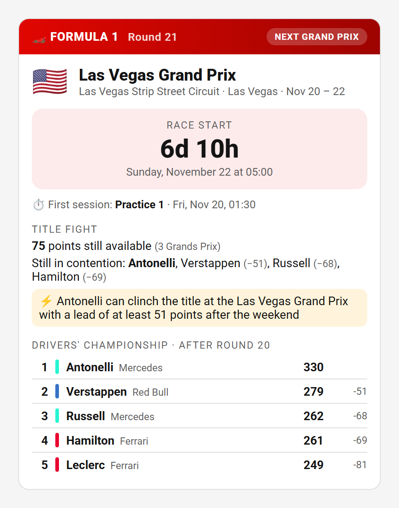
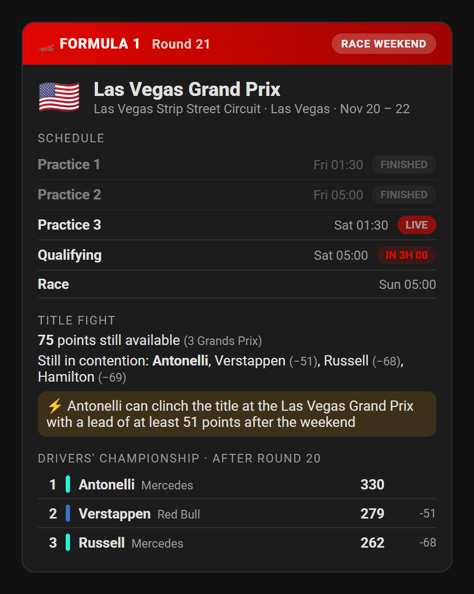
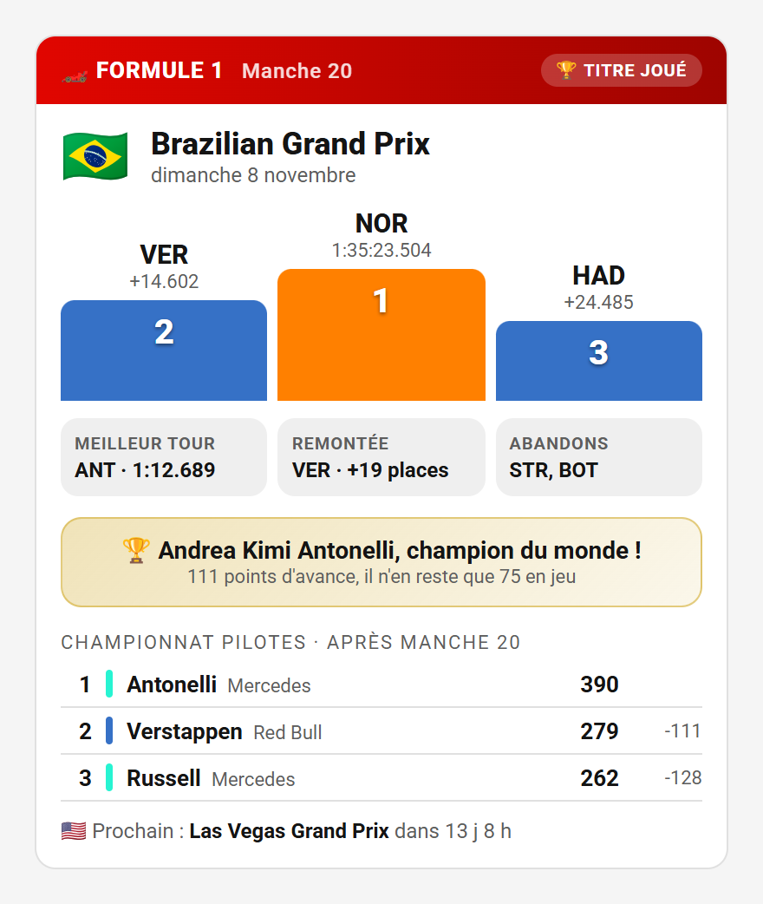
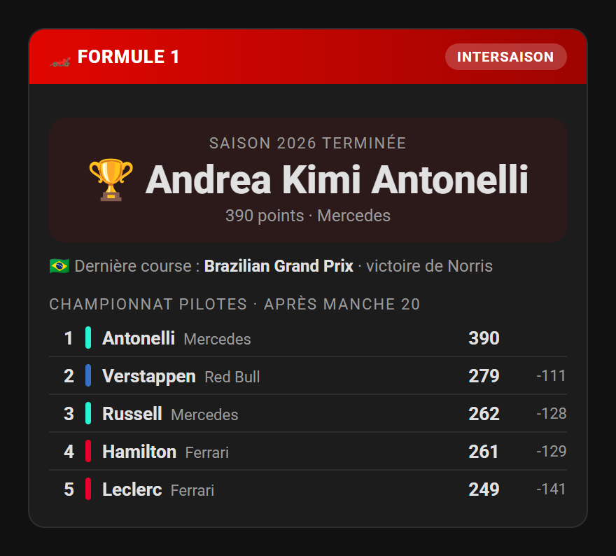

# Formula One Summary Card

[](https://hacs.xyz/docs/faq/custom_repositories)
[](https://github.com/HappyManuDev/Formula-one-summary-card/releases/latest)
[](LICENSE)

A [Home Assistant](https://www.home-assistant.io/) Lovelace card that summarises the **Formula 1 season** and adapts to the calendar: countdown to the next Grand Prix, live schedule during the race weekend, podium after the race, and the mathematical state of the **title fight**.

|                                                                              Next Grand Prix                                                                              |                                                                           Race weekend                                                                            |
| :-----------------------------------------------------------------------------------------------------------------------------------------------------------------------: | :---------------------------------------------------------------------------------------------------------------------------------------------------------------: |
|  |         |
|                                                                                **Results**                                                                                |                                                                          **Off-season**                                                                           |
|     |  |

> [!NOTE]
> **Early version (0.x).** Options may still change before 1.0. Feedback is welcome in the [issues](https://github.com/HappyManuDev/Formula-one-summary-card/issues).

---

## Table of contents

- [Features](#features)
- [Requirements](#requirements)
- [Installation](#installation)
  - [1. Create the F1 sensors](#1-create-the-f1-sensors)
  - [2. Install the card](#2-install-the-card)
- [Configuration](#configuration)
- [Layouts](#layouts)
- [Title fight](#title-fight)
- [Styling](#styling)
- [Localization](#localization)
- [Troubleshooting / FAQ](#troubleshooting--faq)
- [Development](#development)
- [Contributing](#contributing)
- [Credits](#credits)
- [License](#license)

---

## Features

- 🗓️ **Automatic layouts**: next Grand Prix, race weekend, results and off-season. The card switches by itself following the calendar.
- ⏱️ **Countdowns**: to the race start and to the next session, refreshed every minute.
- 🔴 **Live schedule**: during the weekend, every session (practice, sprint, qualifying, race) is shown as finished, live, or with its countdown.
- 🏆 **Podium and highlights**: top three with team colors, fastest lap, biggest climb from the grid, retirements.
- 🧮 **Title fight**: points still available, drivers still in contention, match point at the next event and clinched title, with the 2026 points system.
- 📊 **Championship standings**: with team colors and gap to the leader.
- 🕐 **Respects your profile**: dates and times follow your Home Assistant language, 12 h / 24 h clock and time zone.
- 🌍 **Localized**: English and French.
- 🖱️ **Visual editor**: every option can be set without writing YAML.
- ⚡ **Lightweight**: about 17 kB gzipped, re-renders only when the F1 sensors change.

---

## Requirements

- Home Assistant **2024.8** or newer.
- The four F1 REST sensors described below. They use the free [Jolpica F1 API](https://github.com/jolpica/jolpica-f1), no account or API key needed.

---

## Installation

### 1. Create the F1 sensors

The card reads its data from four [RESTful sensors](https://www.home-assistant.io/integrations/sensor.rest/). Home Assistant fetches the API once an hour and every dashboard shares the result.

1. Copy [`examples/f1-sensors.yaml`](examples/f1-sensors.yaml) into a [package](https://www.home-assistant.io/docs/configuration/packages/), or paste its `rest:` block into `configuration.yaml`.
2. Restart Home Assistant.
3. Check that `sensor.f1_next_race`, `sensor.f1_last_results`, `sensor.f1_driver_standings` and `sensor.f1_schedule` exist in **Developer tools → States**.

> [!TIP]
> These sensors have large attributes (full results, standings and schedule). Exclude them from the recorder, as shown at the end of the example file, to keep your database small and avoid a warning in the logs.

### 2. Install the card

#### HACS (recommended)

1. Open **HACS** in Home Assistant.
2. Click the **⋮** menu (top right) → **Custom repositories**.
3. Repository: `https://github.com/HappyManuDev/Formula-one-summary-card`. Type: **Dashboard**. Click **Add**.
4. Search for **Formula One Summary Card** in HACS, open it and click **Download**.
5. **Reload your browser** (clear the cache if needed).

#### Manual

1. Download `formula-one-summary-card.js` from the [latest release](https://github.com/HappyManuDev/Formula-one-summary-card/releases/latest).
2. Copy it to `<config>/www/formula-one-summary-card.js`.
3. Add the resource in **Settings → Dashboards → ⋮ → Resources → Add resource**. URL: `/local/formula-one-summary-card.js`. Type: **JavaScript module**.
4. Reload your browser.

To check that the card is loaded, open the browser console: a `FORMULA ONE SUMMARY CARD vX.Y.Z` banner is printed.

---

## Configuration

Edit a dashboard, click **Add card** and search for **Formula One Summary Card**. Every option is available in the visual editor, which only saves the options you changed.

### Minimal configuration

```yaml
type: custom:formula-one-summary-card
```

With the sensors of the example file, nothing else is needed.

### Full example

```yaml
type: custom:formula-one-summary-card
mode: auto
show_title_fight: true
show_standings: true
standings_rows: 10
update_interval: 60
next_race_entity: sensor.f1_next_race
last_results_entity: sensor.f1_last_results
standings_entity: sensor.f1_driver_standings
schedule_entity: sensor.f1_schedule
tap_action:
  action: navigate
  navigation_path: /lovelace/f1
```

### Options

| Option                | Type                                                        | Default                      | Description                                                                                   |
| --------------------- | ----------------------------------------------------------- | ---------------------------- | --------------------------------------------------------------------------------------------- |
| `type`                | string                                                      | **required**                 | `custom:formula-one-summary-card`                                                             |
| `mode`                | `auto` \| `week` \| `weekend` \| `results` \| `off`         | `auto`                       | Layout. `auto` follows the calendar, the other values force a layout (handy for testing).     |
| `show_title_fight`    | boolean                                                     | `true`                       | Show the [title fight](#title-fight) block.                                                   |
| `show_standings`      | boolean                                                     | `true`                       | Show the drivers' championship standings.                                                     |
| `standings_rows`      | number (1–30)                                               | 5 or 3                       | Drivers shown in the standings. By default 5 in the week and off-season layouts, 3 otherwise. |
| `update_interval`     | number (10–3600)                                            | `60`                         | Refresh interval of countdowns and live sessions, in seconds.                                 |
| `next_race_entity`    | string                                                      | `sensor.f1_next_race`        | Next race sensor.                                                                             |
| `last_results_entity` | string                                                      | `sensor.f1_last_results`     | Last race results sensor.                                                                     |
| `standings_entity`    | string                                                      | `sensor.f1_driver_standings` | Driver standings sensor.                                                                      |
| `schedule_entity`     | string                                                      | `sensor.f1_schedule`         | Season schedule sensor, used by the title fight.                                              |
| `tap_action`          | [action](https://www.home-assistant.io/dashboards/actions/) | `action: none`               | Action on tap. `more-info` opens the next race sensor.                                        |
| `hold_action`         | [action](https://www.home-assistant.io/dashboards/actions/) | `action: none`               | Action on long press (500 ms).                                                                |

An invalid option shows a clear error message in the dashboard instead of the card.

---

## Layouts

With `mode: auto`, the card picks its layout from the sensors:

| Layout              | When                                                  | Content                                                               |
| ------------------- | ----------------------------------------------------- | --------------------------------------------------------------------- |
| **Results**         | Up to 50 hours after the start of the last race       | Podium, fastest lap, biggest climb, retirements, standings, next race |
| **Race weekend**    | From 24 hours before the first session of the next GP | Session schedule with finished / live / countdown status, standings   |
| **Next Grand Prix** | The rest of the season                                | Countdown to the race start, first session, standings                 |
| **Off-season**      | No next race in the calendar                          | Champion, last race winner, final standings                           |

Session times use approximate durations (60 minutes for practice, qualifying and sprint, 45 for sprint qualifying, 120 for the race) to show a session as live.

---

## Title fight

The title fight block uses the **2026 points system**: 25 points for a Grand Prix win, 8 for a sprint win, no fastest lap point. It shows:

- the **points still available** and the remaining Grands Prix and sprints;
- the drivers **still in contention**, with their gap to the leader;
- a **match point** when the leader can clinch the title at the next event, with the lead they need after that weekend;
- a **champion** banner, and a 🏆 tag in the header, as soon as the title is mathematically decided.

The tie-break on number of wins is not taken into account: a tie on points is never shown as clinched.

---

## Styling

The card follows your Home Assistant theme for texts, background and dividers. The header color can be changed with CSS variables, in a theme or with [card-mod](https://github.com/thomasloven/lovelace-card-mod):

| Variable                   | Default   | Applies to                                      |
| -------------------------- | --------- | ----------------------------------------------- |
| `--f1sc-accent-color`      | `#e10600` | Header, live session pill, countdown background |
| `--f1sc-accent-dark-color` | `#9e0400` | End of the header gradient                      |

```yaml
card_mod:
  style: |
    :host {
      --f1sc-accent-color: #00594f;
      --f1sc-accent-dark-color: #003b34;
    }
```

---

## Localization

The card uses the language of your Home Assistant profile.

| Language | Code |
| -------- | ---- |
| English  | `en` |
| French   | `fr` |

Race and circuit names come from the API, in English. To add a language, see [CONTRIBUTING.md](CONTRIBUTING.md#adding-a-language).

---

## Troubleshooting / FAQ

**"Entity not found: sensor.f1_next_race"**: the sensors are missing. Follow [Create the F1 sensors](#1-create-the-f1-sensors), or set the `*_entity` options if your sensors have other names.

**The flags show as two letters (US, BR…)**: Windows does not include flag emojis. This is a limitation of the operating system, not of the card.

**The data is late after a race**: the sensors refresh once an hour, and Jolpica publishes the results a little while after the race. You can refresh a sensor right away with the `homeassistant.update_entity` action.

**A session is shown at the wrong time**: times are converted to the time zone of your Home Assistant profile (**Profile → Time zone**: browser or server).

---

## Development

```bash
npm install
npm test             # unit tests (Vitest)
npm run lint         # ESLint
npm run build        # type check and production bundle in dist/
npm run dev          # rebuild on change
npm run screenshots  # README images, needs Chrome
```

| Path                   | Content                                                                |
| ---------------------- | ---------------------------------------------------------------------- |
| `src/f1/`              | Pure functions: sensor data, sessions, layout, title fight, race facts |
| `src/render/blocks.ts` | Lit templates of each block                                            |
| `src/editor.ts`        | Visual editor                                                          |
| `src/localize/`        | Translations                                                           |
| `test/fixtures/`       | Real Jolpica API answers used by the tests and the screenshots         |

---

## Contributing

Bug reports, translations and features are welcome. See [CONTRIBUTING.md](CONTRIBUTING.md).

---

## Credits

- F1 data from the [Jolpica F1 API](https://github.com/jolpica/jolpica-f1).
- Built with [Lit](https://lit.dev/).

This project is unofficial and is not associated in any way with the Formula 1 companies. F1, FORMULA ONE, FORMULA 1 and related marks are trade marks of Formula One Licensing B.V.

---

## License

[MIT](LICENSE)
